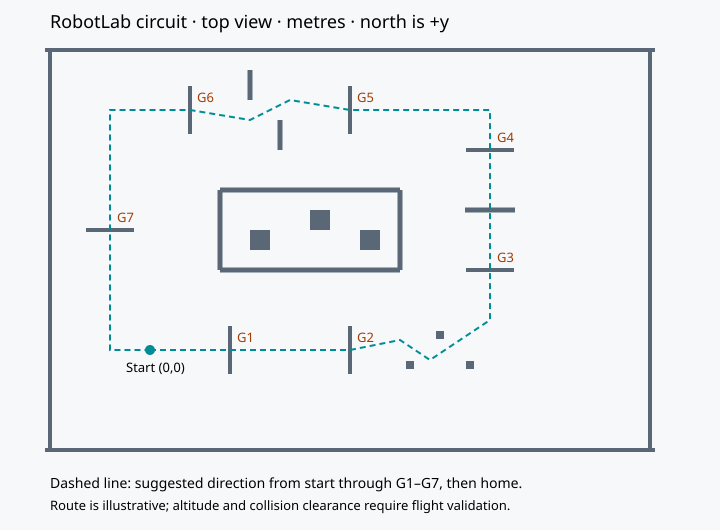

# 2. Simulation, worlds, and recordings

How a Gazebo mission runs, which sensors exist, how worlds are generated and
edited, and what each run records. Commands and options are in the
[README](../README.md#running).

## Gazebo runtime

DroneLab runs a self-contained quadrotor in Gazebo Harmonic (8.x) through
native Gazebo transport, with Rerun 0.24.1. ROS nodes, PX4, and Fuel model
downloads are not required. RotorPy is not part of this runtime.

Gazebo owns physics (0.002 s step by default), native multicopter motor and
velocity plugins, contacts, and sensor simulation. The vehicle is a
simplified 1.54 kg rigid body with a 0.48 × 0.48 × 0.12 m box contact model
(no propeller/arm collision geometry), and four `MulticopterMotorModel`
rotors. It is not calibrated against a real vehicle.

## Mission lifecycle

`cli.gazebo` builds a `GazeboConfig` and calls `experiments.gazebo.run`. It
loads the JSON scene (also when `--world` is given) and either generates SDF
or uses the saved world.

- **Generate-only** writes `world.sdf` and `drone-resolved.json`, then exits
  before loading transport or Rerun.
- **Edit** opens a paused Gazebo world without a mission or recorder.
- **Mission** subscribes to Gazebo transport, creates the recorder, and
  launches Gazebo as a child process in a per-run transport partition, so
  concurrent local runs cannot exchange messages.

Transport callbacks only enqueue messages into a bounded queue (4,000
entries; overflows are counted, `simulation/gazebo/ingress.py`). The mission
loop (`experiments/mission_loop.py`) drains it serially, one message at a
time, through these stages:

1. **Housekeeping:** live-EKF and thrust-worker health, keyboard input and
   effects, watchdogs, Gazebo process liveness.
2. **Measurement pipeline** (`sensor_pipeline.py`): error and fault
   models, then recording, sensor status, and the sensor bus; then the
   estimator runner and the live EKF.
3. **Truth step**, per odometry sample: payload and moving obstacles,
   Python external forces (`vehicle_forces.py`), synthetic sensors,
   evaluation and health, `telemetry.jsonl`, then the rotor-thrust tick
   (`rotor_mission.py`) or a velocity command, then the lockstep advance.
4. Poses feed payload and moving obstacles; contacts feed the health
   verdict.

The stage order is part of the behaviour (seeded models draw per call), so
lockstep runs stay byte-identical across refactors. Mission duration is measured from the first odometry
timestamp. Loss of odometry for 30 wall-clock seconds raises an error
(rotor-thrust modes use a stricter 1 s watchdog, see [4 Control](4_control.md)).
Cleanup sends a zero command, stops Gazebo, and writes summary and
recording data; interrupted missions are marked incomplete. A completed run
missing a required sensor stream raises an error. Contacts never stop a
mission, and there is no obstacle avoidance.

### Stopping and cleanup

Gazebo is a child process owned by the run
(`simulation/gazebo/process.py`). `gz sim` is a launcher: server-only it
runs the server itself; with the GUI it forks `gz sim server` and
`gz sim gui` into their own process groups. SIGTERM to the launcher stops
both, but if the launcher or Python is killed outright they kept running.
Now:

| Event | What happens |
| --- | --- |
| Ctrl-C or SIGTERM to `dronelab`, `dronelab-magcal`, `dronelab-imucal` | Treated alike (`experiments/interrupts.py`): the mission saves `summary.json` (`exit_reason: interrupted`, health warning), Gazebo is stopped; exit status 130 (Ctrl-C) or 143 (SIGTERM). A second signal during this cleanup is ignored, so it cannot leave Gazebo or half-written results behind. |
| Python killed (SIGKILL, out of memory) | Gazebo is launched under `setpriv --pdeathsig TERM` (util-linux), so the kernel sends it SIGTERM and it exits. No summary is written. Without `setpriv` (non-Linux) Gazebo keeps running. |
| Gazebo ignores SIGTERM for 10 s | The launcher and every descendant process are killed. |
| Gazebo exits during start-up | Lockstep runs fail at once ("Gazebo exited during start-up") instead of after the 60 s subscriber timeout; real-time runs already checked liveness every loop iteration. |
| Gazebo exits during a calibration | `dronelab-magcal`/`-imucal` fail at once, naming `gazebo.log`, instead of after a 10 s sensor timeout. |
| Runtime error | The command prints the error, the output directory, and the health verdict, and exits 1 (invalid options or configuration still print usage and exit 2). |

Verified on the reference desktop (gz sim 8, Jazzy): SIGTERM and SIGKILL
to headless and GUI missions leave no `gz` processes; SIGTERM to a
2-parallel batch stops both children, which save their summaries; killing
Gazebo during lockstep start-up fails in 1.6 s.

## Ground start and take-off

By default the drone spawns airborne at `simulation.spawn_position_m` with
its motors stopped, so every run begins with a brief sag (up to 0.65 m for
the heavy-lift preset). With `simulation.start_on_ground: true`
(`configs/scenarios/ground_start.json`) it rests on the ground at the spawn
x, y, its body box on the ground plane. In rotor-thrust and keyboard modes an
automatic take-off (`experiments/takeoff.py`, mission logic) then replaces
pilot or scripted commands with a climb at `pilot.takeoff_climb_mps` until
the controller's altitude setpoint reaches `pilot.takeoff_altitude_m`, and
hands over. Velocity mode needs no sequence: the native controller climbs to
the waypoint. Ground contacts during take-off appear in `collisions`; the
summary field `takeoff` records completion time.

Verified in lockstep with every vehicle preset: lift-off within 0.3 s,
take-off complete at about 1.2 s, no tilt, hover settled at 1.005–1.010 m
with at most 4 cm overshoot. Ending the climb on vehicle height instead of
the setpoint left hovers about 0.3 m high, because the controller's
minimum-altitude rule makes the setpoint lead the vehicle. There is no
landing sequence or landing gear model; the body box is the contact shape.

## Odometry start-up correction

Measured with gz-sim 8: Gazebo's OdometryPublisher reports velocities as if
the vehicle started at the world origin for the first 20 ms of simulation
time (a drone at rest 1 m up reported +500, +167, +100, +71, +55 m/s in its
first five 250 Hz samples). Before this was found, every rotor-thrust run fed
the controller one bogus sample at start, and quadratic body drag turned it
into a 10⁷ N force that crashed Gazebo's physics. For the first 25 ms after
the first sample the mission therefore replaces reported velocity and body
rates with finite differences of consecutive poses (zero for the first
sample); `summary.json` counts these as `odometry_startup_corrections`.
Correcting it reduced the heavy-lift spawn sag only from 0.66 to 0.61 m;
most of the sag is real motor spin-up.

## Real-time loop timing

In real time Gazebo does not wait for Python: the mission loop must handle
each simulated second of messages in less than a wall second. When it
cannot, messages queue up, control acts on older and older states, and
rotor-thrust missions abort with "Stale odometry in rotor-control queue"
once odometry is 0.25 s old when processed. `summary.json.loop_timing`
measures this on every run (`experiments/loop_timing.py`):

| Field | Meaning |
| --- | --- |
| `load` | Busy wall seconds of the loop per simulated second (keep well below 1 in real time; in lockstep it is the wall cost per simulated second) |
| `odometry_queue_age_ms` | Mean and maximum wall time from odometry receipt to processing; `late` counts samples older than `late_threshold_ms` (50 ms) |
| `per_kind` | Busy wall seconds, message count, and slowest single message (ms) per message kind, plus `housekeeping` (keyboard, watchdogs, health checks) |

Slowest-message values include start-up (first window map, first control
tick). Two costs dominated 250 Hz keyboard flight (`racing_5in`) and are
now bounded: the keyboard window is serviced at most every 20 ms of wall
time (it used to redraw for every message), and Rerun scalar series are
sent in batches (see [Viewing](#viewing)). Measured on the reference
desktop for a 15 s `racing_5in` keyboard hover: load 0.94 → 0.57 and
mean odometry queue age 3.8 → 0.4 ms, with no late samples (also with the
Gazebo GUI open). The opt-in `tests/integration/test_gazebo_realtime.py`
checks a headless 250 Hz flight stays below load 0.85 with no late
odometry; it measures the machine it runs on.

## Lockstep simulation

By default Gazebo runs in real time on its own clock while all Python work
(decoding, sensor models, EKF, Rerun, controller) shares one thread, so
Python's processing time silently adds control latency and runs are not
repeatable. With `simulation.lockstep: true`
(`configs/control/lockstep.json`) Gazebo starts paused and Python advances it
one odometry period at a time (`simulation/gazebo/stepping.py`):

1. Before the first burst, Python waits until Gazebo has subscribed to
   every command topic it publishes (motors, wind, wrench, payload, ...):
   messages published before transport discovery connects are lost
   silently, and once left a ground-start run with motors that never spun.
2. Python requests a burst of physics steps through `/world/dronelab/control`.
3. The odometry message at the end of the burst (time T) is the barrier.
4. Python processes the period in a fixed order
   (`simulation/gazebo/ingress.py`, `LockstepOrderer`): it waits until every
   scheduled sensor has delivered its last sample stamped ≤ T (Gazebo
   samples a sensor of period P at the first step at or after k·P), then
   handles all messages stamped ≤ T by timestamp, measurements before the
   odometry at equal stamps. Messages Gazebo repeats while paused (joint
   states, poses, contacts) are dropped as duplicates.
5. Python processes everything (controller tick, motor commands, wind),
   republishes the current command once (in place of the wall-clock thrust
   worker, which lockstep does not start), then requests the next burst.

Python's processing time therefore costs no simulation time. Gazebo
delivers topics on separate threads, so arrival order varies between
otherwise identical runs; step 4 makes processing independent of it.
Verified under full CPU load (16 busy processes, 5 identical runs each,
byte-identical telemetry, commands, estimates, and metrics): ground start
with IMU vibration; battery, ESC, ground start and rotor aerodynamics on
the square; sensor errors with magnetometer interference and the EKF on the
circle; static wind; Python body drag.

**Command barrier (`simulation.lockstep_barrier`).** Commands reach Gazebo
as topic messages and step requests through the control service, a
separate connection, so under heavy load Gazebo could start a burst before
reading that period's commands, which then took effect one period late
(seen with dynamic wind and with rendered sensors). The `DronelabLockstep`
system plugin (`gazebo_plugins/lockstep/`, C++) closes this: before each
step request Python publishes a grant (the period's end time) on the
commands' own ordered connection, and the plugin, first in the world,
holds the burst's first step until the grant, and so every earlier
command, has been read. Paused iterations are never held, so rendered
sensors keep publishing between bursts. Lost early grants are re-sent
every 0.25 s (harmless: grants only grow); step requests are never
re-sent in this mode, and a burst that does not finish within 10 s is an
error.

| `lockstep_barrier` | Behaviour |
| --- | --- |
| `auto` (default) | Plugin when built, else service |
| `plugin` | Plugin; error if not built |
| `service` | Control service only; commands can apply one period late under load, and a stalled burst is re-sent after 2 s, which can double-step |

Build the plugin once with `dronelab-build-plugins` (needs cmake, a C++17
compiler, and the Gazebo development files; output in
`build/gazebo_plugins`, or set `DRONELAB_PLUGIN_DIR`).
`DRONELAB_LOCKSTEP_DEBUG=1` makes the plugin report grants and holds in
`gazebo.log`. `summary.json.lockstep.barrier` records the mode used.

Verified under full CPU load with the plugin: turbulence (6 of 6 runs
identical; 1 of 6 diverged with the service barrier) and the circuit with
camera, 3D lidar, rangefinder, and rain (4 of 4 flights identical; every
run diverged before).

**Rendered sensors** (camera, lidar, GPU rangefinder) are rendered
asynchronously, and Gazebo shifts or skips frames with rendering speed
(a 30 Hz camera produced a frame at 464 ms instead of 468 ms), so their
data is not reproducible bit-for-bit and the orderer does not wait for
them. The flight stays deterministic as long as they do not feed control.

Implementation notes, measured on gz-sim 8:

- Motor commands published just before a step request are applied in that
  step on an unloaded machine (identical trajectories with and without an
  added 5 ms delay); under load see the limitation above.
- The control service's reply is unreliable from Python (5–43 % of replies
  lost depending on the timeout) although every burst runs. Replies are
  therefore ignored (counted as `lost_replies`); a burst is re-sent only if
  its odometry barrier has not arrived after 2 s (`resends`).

Requirements: the odometry period must be a whole number of physics steps;
rotor-thrust mode needs `control.publish_on_send`. Not available with
`--keyboard` (interactive flight needs real time), `--world`, or `--edit`.
Wall-clock watchdogs that guard against a stalled Python while Gazebo keeps
flying are disabled, because Gazebo cannot advance while Python stalls.
`summary.json` field `lockstep` reports bursts, steps per burst, lost
replies, and resends; `message_ordering` reports dropped duplicates and
`barrier_timeouts` (periods released after 5 s without a scheduled sample;
determinism is then not guaranteed, and the health verdict warns). Rendered sensors keep their full frame count.

## Sensors

| Data | Default rate | Topic | Rerun view |
| --- | --- | --- | --- |
| Ground-truth odometry | 50 Hz | `/dronelab/odometry` | Pose, path, tracking error |
| IMU | 200 Hz | `/dronelab/imu` | Acceleration and angular-rate plots |
| GPS/NavSat | 10 Hz | `/dronelab/gps` | Latitude, longitude, altitude plots |
| Barometer (optional) | 50 Hz | `/dronelab/baro` | Pressure (Pa) and pressure altitude (m above sea level) |
| Magnetometer (optional) | 50 Hz | `/dronelab/magnetometer` | Field (µT, sensor axes) and level-compass yaw |
| Rangefinder (optional, rendered) | 20 Hz | `/dronelab/rangefinder` | Downward range (m) |
| Optical flow (optional, synthetic) | 50 Hz | Python model, no topic | Raw flow (rad/s), distance, validity |
| Battery monitor (optional, synthetic) | 10 Hz | Python model, no topic | Measured voltage, current, remaining % |
| Camera (optional) | 10 Hz | `/dronelab/camera` | 320 × 240 RGB image; pinhole or fisheye, optional blur, rolling shutter, distortion, latency |
| Lidar (optional, rendered) | 10 Hz | `/dronelab/lidar` | 360-ray scan, 0.15–50 m; 2D by default, multi-channel 3D when configured |
| Body contact | Physics-driven | `/dronelab/contacts` | Contact event log |

- Default mounts: camera along body +X, 0.3 m forward and 0.1 m up; lidar
  0.2 m above the body; IMU and GPS at the body origin. Mounts, rates, and
  Gaussian noise/bias are configurable ([3 Configuration](3_configuration.md)).
  Defaults are ideal (no noise).
- Camera, lidar, and rangefinder need the rendering system, including EGL in server-only
  mode. They are off by default so physics, IMU, GPS, and contacts work
  without a GPU. `--render-sensors` enables camera and lidar (not the rangefinder); DroneLab
  changes no GPU settings.
- Lidar scans are drawn under the moving drone frame with the mount applied;
  no motion deskewing.
- Seeded sensor-error and fault models run at the Python mission boundary,
  before recording and the EKF; raw Gazebo topics are unchanged. Order per
  sample: IMU errors → vibration/clipping → IMU faults; GPS errors →
  multipath → dropout (random, scheduled, zone); barometer datum shift →
  barometer errors. See [3 Configuration](3_configuration.md#fault-injection).
- The barometer is off by default. Gazebo reports pressure for the sensor's
  local z as height above sea level (the installed gz-sensors 8 ignores
  `<reference_altitude>`), so the mission shifts it to the world's 650 m
  elevation, the same datum as GPS altitude. Verified in a Gazebo hover:
  pressure altitude equals 650 m + true z to within 1 µm. Opening the SDF
  directly gives the sea-level datum.

## Viewing

Gazebo is the interactive world; Rerun is the telemetry and replay view.
Select the `sim_time` timeline in Rerun. Rerun shows the blue truth vehicle
and path, the magenta EKF vehicle and path with `--ekf`, forward arrows for
body +X, an **EKF vs truth** tab, and a **Rotor thrust targets (N)** tab in
thrust modes. Displayed paths keep at most 2,000 vertices; files keep every
sample. Scalar time series are buffered and sent in batches covering 0.1 s
of simulation time (every sample and timestamp is kept), so a live viewer
shows them up to that much later than 3D poses. Rerun loads box visuals from the world at startup and tracks model
poses; objects added or removed during flight, meshes, non-box shapes, and
link-level rotations are not fully synchronized. Gazebo stays authoritative
for geometry, rendering, and contacts. Close the Rerun viewer yourself.
Replay with `rerun <output>/flight.rrd` using the `rerun` from the same venv.

**Sensor indicators.** Each enabled sensor has a coloured marker (no text label) at
its mount on the drone; directional sensors (camera, rangefinder, optical
flow) also show an arrow along their +x axis, and the rangefinder draws its
ray to the measured hit (hidden when out of range). The **Sensor status**
tab plots health indicators: `gps_delivered` (0 when a fix is dropped by
random, scheduled, or zone dropout), `gps_multipath` (1 during an episode),
`imu_faults_active` (number of active fault events), `rangefinder_valid`,
`optical_flow_valid`, and `motor_<i>_thrust_available` (1 = healthy rotor). These use the mission's own fault-model state; they
show what was injected, not what an estimator could detect.

## Worlds

### JSON scenes

Scenes in `worlds/` contain named static boxes: centre positions and full
x/y/z sizes in metres. Keep sizes positive and names unique; a box resting on
the ground has z = height / 2. Optional `reflectivity` per obstacle and
scene-level `ground_reflectivity` (also used for terrain), in (0, 10], set
the lidar return strength ([lidar realism](3_configuration.md#lidar-realism-sensorslidareffects)).
Optional `magnetic_moment_am2` ([x, y, z], A·m², world axes) makes an
obstacle a magnetic dipole for the magnetometer
([anomalies](3_configuration.md#magnetometer-sensorsmagnetometer)). Visual and collision sizes are generated
together. `worlds/training.json` is the default scene.

### Editing and saved worlds

```bash
dronelab --edit --render-sensors --output outputs/editor
```

1. Insert shapes with Gazebo's toolbar and place them with the translate and
   rotate tools. Inserted shapes may be dynamic; set them static in SDF for
   immovable obstacles. For exact sizes, edit the JSON scene or saved SDF.
2. Save while paused at the initial state via the file menu **Save world**,
   e.g. `worlds/my-world.sdf` (not "Save GUI configuration").
3. Fly it with `--world worlds/my-world.sdf`.

Keep the world named `dronelab`, the drone named `drone`, and its plugins and
topics intact. `--world` uses the SDF without regenerating; `--drone`,
`--keyboard`, and `--ekf` are rejected with saved worlds. Without `--world`,
each run regenerates `<output>/world.sdf`.

### Terrain (`terrain` in a scene)

`worlds/hills.json` adds rolling terrain (`simulation/terrain.py`): seeded
Gaussian hills on the ground plane inside a square, with a flat disc around
the origin for spawning.

| Key | Default | Meaning |
| --- | --- | --- |
| `seed` | 0 | Hill placement, heights, widths |
| `size_m` | [60, 60] | Terrain square (m), centred on the origin |
| `resolution_m` | 1.0 | Mesh grid spacing (m) |
| `hills` | 12 | Number of hills |
| `max_height_m` | 3.0 | Maximum height of one hill; overlapping hills add up |
| `hill_radius_m` | [3, 10] | Range of hill widths σ (m) |
| `flat_radius_m` | 5.0 | Flat disc around the origin (blends in over the same distance) |

The same height function generates the triangle mesh Gazebo uses for
collision and visuals (`terrain.obj` next to `world.sdf`, with vertex normals,
which Gazebo's DART collision requires; without them it crashes), Rerun's
terrain mesh, and the ground used by optical flow, ground effect, and ground
start. Take-off altitude is measured above the take-off point. Verified in
lockstep: a drone started on a hillside rested exactly on the surface and
took off 1 m above it; flying over the hills, Gazebo's rangefinder (mesh) and
the optical-flow distance (Python terrain) agreed within 1.1 cm over 250
samples. Moving or static obstacles under the vehicle are still ignored by
flow and ground effect.

### Moving obstacles (`moving_obstacles` in a scene)

Boxes that patrol waypoint paths at constant speed, on the ground or flying
(waypoints are full 3D points). `worlds/moving.json` has a ground cart, a
flyer looping a 3D circuit between 2 and 3.5 m, and a crosser that passes
through the default hover point.

```json
{"name": "flyer", "size": [0.5, 0.5, 0.3], "speed_mps": 2.0, "mode": "loop",
 "waypoints": [[-4, -4, 2.0], [4, -4, 3.0], [4, 4, 2.5], [-4, 4, 3.5]]}
```

`mode` is `pingpong` (back and forth) or `loop` (return to the first
waypoint). Each obstacle is a 1000 kg, gravity-free box driven by Gazebo's
VelocityControl system, so sensors see it and collisions are physical (the
drone yields). Python (`simulation/moving_obstacles.py`) commands the path
velocity plus feedback on the measured pose, so obstacles stay on their path
over many laps; path time is absolute simulation time. Verified in lockstep:
path errors 5–10 cm median, 12 cm maximum (Gazebo publishes obstacle poses at
about 12 Hz, so feedback uses slightly old poses); the crosser reached the
hovering drone at 4.97 s, was recorded as a collision, and pushed it 9 m.
Rerun follows moving obstacles. During keyboard flight, key 7 spawns an
extra flying object (see [4 Control](4_control.md#keyboard-effect-toggles)).

### Obstacle circuit

`worlds/circuit.json` is a 60 × 40 m arena with walls at x = −10/50 m and
y = −10/30 m, inside the 100 × 100 m ground plane. The drone starts at
(0, 0, 1) m in an open launch area.



The suggested lap goes east along the southern lane, north along the eastern
lane, west along the northern lane, and south back to launch.

| Gate | Centre x, y (m) | Travel direction | Suggested crossing z (m) |
| --- | --- | --- | --- |
| G1 | 8, 0 | East (+x) | 1.8 |
| G2 | 20, 0 | East (+x) | 2.2 |
| G3 | 34, 8 | North (+y) | 1.8 |
| G4 | 34, 20 | North (+y) | 1.8 |
| G5 | 20, 24 | West (−x) | 1.8 |
| G6 | 4, 24 | West (−x) | 1.8 |
| G7 | −4, 12 | South (−y) | 1.8 |

Each gate has 4 m clear width and 3 m clear height (two posts and a lintel).
G2 has a 0.8 m sill, so its opening spans z = 0.8–3.8 m. After G2, three
3.5 m slalom pillars near x = 26, 29, 32 m; a 1 m hurdle crosses the eastern
lane at y = 14 m; staggered 2 m walls sit near x = 13 and 10 m on the
northern lane; a walled central island has towers up to 5 m. Boundary walls
are 2 m high and the arena is open overhead. Allow clearance for the whole
vehicle, not just its centre.

The dashed route is illustrative only. The CLI accepts one fixed `--target`,
so targeting a late gate flies straight at it. Autonomous laps need a
waypoint-sequence runner ([6 Roadmap](6_roadmap.md)). If you change the
layout, update `circuit.svg` too.

```bash
dronelab --scene worlds/circuit.json --target 11 0 1.8 --duration 20 --render-sensors --output outputs/circuit-g1
dronelab --headless --target 8 0 1 --duration 10 --output outputs/collision   # deliberately hit the training wall
```

## Run artifacts

| File | Contents |
| --- | --- |
| `world.sdf` | Generated world (generated runs only) |
| `drone-resolved.json` | All resolved settings, derived mass/weight/thrust limit, SHA-256 hash |
| `flight.rrd` | Rerun recording with simulation timestamps |
| `telemetry.jsonl` | Ground-truth poses |
| `commands.jsonl` | Rotor-control records: requested thrusts, motor-speed targets, setpoints, saturation, command IDs, accepted thrusts, expiry, tick/state/release times |
| `command-events.jsonl` | Command publication, supersession, expiry, stop, and failure events |
| `estimates.jsonl` | EKF state, covariance, and provenance (`--ekf`) |
| `wind-commands.jsonl` | Published dynamic wind targets (random/scheduled wind) |
| `replay.jsonl` | Bus deliveries and truth for `dronelab-replay` (`algorithms.record_bus`) |
| `algorithm-debug.jsonl` | Plug-in debug series (`context.log`), only when a plug-in logs |
| `camera-first.png` | First camera frame (rendered runs) |
| `summary.json` | Lockstep `message_ordering`, health verdict and findings ([7 Experiments](7_experiments.md#run-health-verdict-health)), completion, exit reason, message counts, drops, contacts, final position, control mode and state source, config hash, timing, `control_timing` and `loop_timing` ([Real-time loop timing](#real-time-loop-timing)), EKF/dropout/vibration/sensor-error/fault diagnostics |
| `gazebo.log` | Gazebo process output |

Reusing an output directory overwrites these files and can leave stale
optional ones; use a new directory per dataset. Check `summary.json`
health verdict, completion, stream counts, and dropped counters before
trusting a dataset.
Long sessions grow recordings and in-memory path histories.
